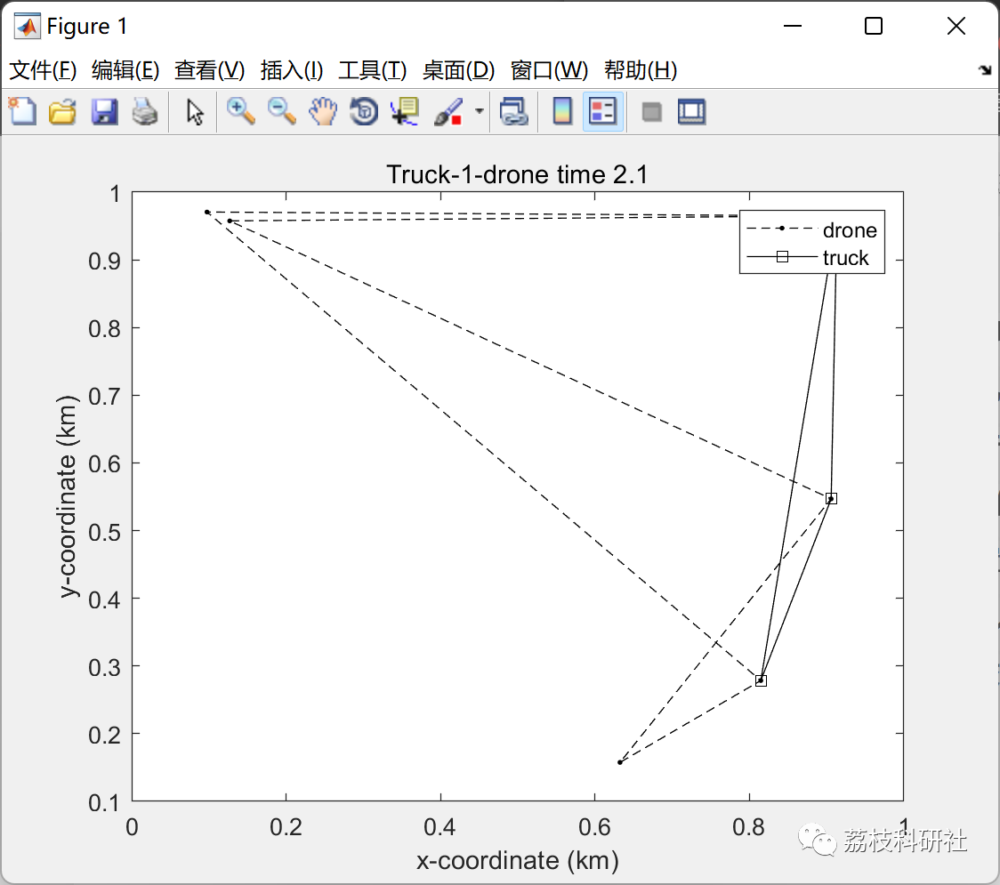

# Travel Salesman Problem for Truck Drone Based on Genetic Algorithm (Matlab Code Implementation)

💥💥💞💞 Welcome to this blog❤️❤️ 💥💥
🏆 Bloggers' Advantages: 🌞🌞🌞 The content of the blog strives for rigorous thinking and clear logic to facilitate readers.
⛳️ Mantra: A journey of a thousand miles is begun with a single step. Table of Contents
📝1 Overview
📝2 Running Results
📃3 References
📋4 MATLAB Code Implementation
🎁 Special Section Link:

🌈🌈🌈 Path Planning, Neural Network Prediction, Electrical Codes, Intelligent Algorithms and Their Applications, Optimization Scheduling, Image Processing, Workshop Scheduling, Signal Processing, Romantic Her, Mathematical Modeling🌟🌟🌟
📋1 Overview
This article utilizes genetic algorithms to solve the "last mile" problem of the Traveling Salesman Problem (TSP) for truck drones in the UPS or FedEx operations. Each truck carries a drone that launches from one station, transporting packages within its range to nearby stations while operating alongside the truck. The drone is limited by its range and capacity. Therefore, it must operate near the truck. The operation involves the truck launching the drone, the truck and drone moving to different locations, then the truck collecting the drone at a meeting point for battery replacement and loading. The idea is to determine the routes for trucks and drones (and operations) to minimize total time. Total time is based on the operation (start-delivery-recovery) time. The maximum time for an operation (truck or drone) is used to calculate the total route time.
📝2 Running Results
📃3 References
[1] Huang Shuzhao, Tian Junwei, Qiao Lu, Wang Qin, Su Yu. Improved Genetic Algorithm for Drone Path Planning [J]. Computer Application, 2021, 41(02):390-397.
📋4 MATLAB Code Implementation
Click the left bottom corner of the article to read more.

## Images

<!-- PAYMENT_BLOCK -->

## Get this dataset

- Payment link (Stripe): [Buy now](https://buy.stripe.com/3cs8yP7sY87d0vu9AB)
- Payment QR code: 

<!-- /PAYMENT_BLOCK -->
